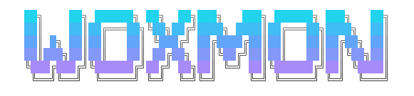
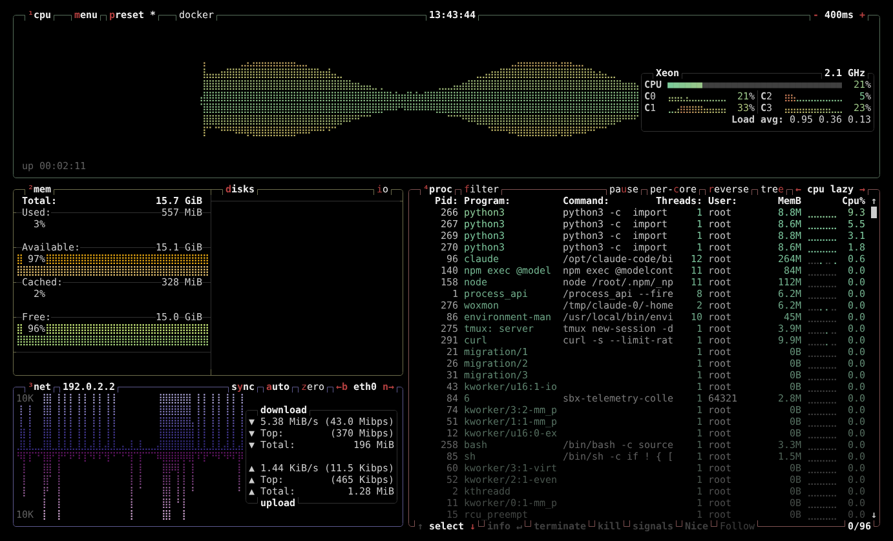
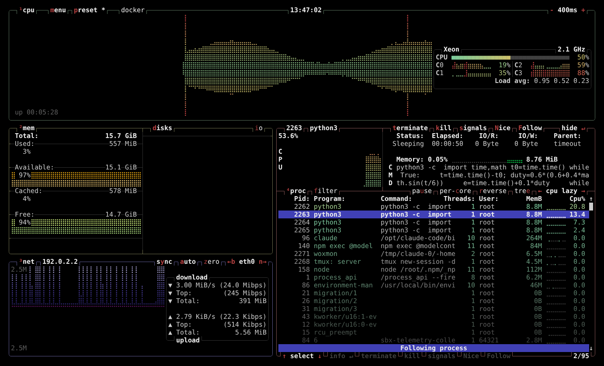
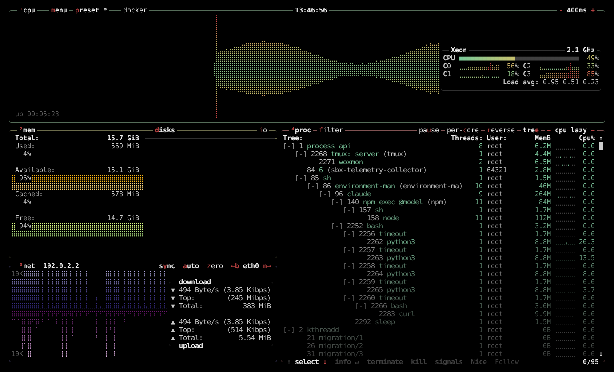
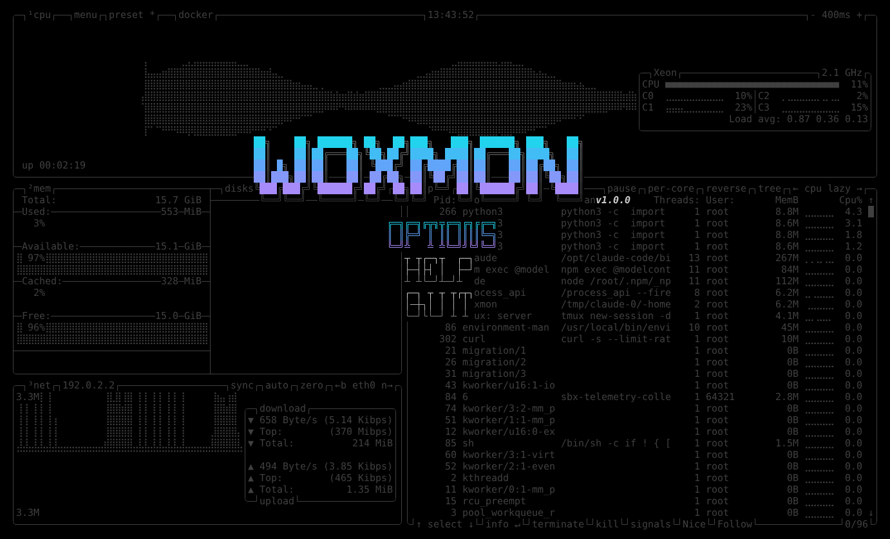

<p align="center">
  
</p>

<p align="center">
  <b>WiamOX Monitor</b> — the system monitor of WiamOX.<br>
  CPU, memory, disks, network, GPU and processes, live in your terminal.
</p>

<p align="center">
  
  
  
  
  
</p>

<p align="center">
  
</p>

---

## Contents

- [Features](#features)
- [Screenshots](#screenshots)
- [Install](#install)
- [Use](#use)
- [GPU support](#gpu-support)
- [Configuration](#configuration)
- [Build from source](#build-from-source)
- [License](#license)

## Features

- **CPU**: total and per-core usage graphs, frequency, temperatures, load average, uptime, battery
- **Memory**: used, available, cached and free memory, swap
- **Disks**: usage and read/write speed of every mounted disk
- **Network**: download and upload speed with graphs, per network device
- **GPU**: usage, memory, temperature, power and clock speed for NVIDIA, AMD and Intel GPUs, shown by default
- **Processes**: sort by any column, tree view, filter (also with regular expressions), details of one process, terminate, kill, send any signal, change nice values
- **Keyboard and mouse**: every action has a key, every button in a box title can be clicked
- **Presets**: switch between layouts with `p`, or show and hide boxes with `1` … `0`
- **Themes**: truecolor, 256-color and 16-color (TTY) modes, your own `.theme` files
- **Light**: one small binary, no runtime dependencies; GPU libraries are loaded only when present

## Screenshots

<table>
  <tr>
    <td align="center"><br><sub><b>Process details</b> (<kbd>Enter</kbd>): CPU graph, memory, command, quick actions</sub></td>
    <td align="center"><br><sub><b>Tree view</b> (<kbd>e</kbd>): processes grouped under their parents</sub></td>
  </tr>
  <tr>
    <td align="center" colspan="2"><br><sub><b>Menu</b> (<kbd>Esc</kbd>): options, help, quit</sub></td>
  </tr>
</table>

## Install

On WiamOX:

```sh
wox install woxmon
```

Then open **WiamOX Monitor** from the app launcher, or type `woxmon` in a terminal.

## Use

| Key | What it does |
|---|---|
| <kbd>Esc</kbd> or <kbd>m</kbd> | menu |
| <kbd>h</kbd> or <kbd>F1</kbd> | list of all keys |
| <kbd>o</kbd> or <kbd>F2</kbd> | options (theme, update speed, which boxes, graphs, …) |
| <kbd>1</kbd> <kbd>2</kbd> <kbd>3</kbd> <kbd>4</kbd> | show or hide the CPU, memory, network and process box |
| <kbd>5</kbd> … <kbd>0</kbd> | show or hide the boxes of GPU 1 … 6 |
| <kbd>p</kbd> / <kbd>P</kbd> | next / previous view preset |
| <kbd>f</kbd> or <kbd>/</kbd> | filter processes (start with `!` for a regular expression) |
| <kbd>↑</kbd> <kbd>↓</kbd>, <kbd>Enter</kbd> | select a process, show its details |
| <kbd>t</kbd> / <kbd>k</kbd> / <kbd>s</kbd> | terminate / kill / send a signal to the selected process |
| <kbd>e</kbd> | tree view |
| <kbd>+</kbd> / <kbd>-</kbd> | update faster / slower |
| <kbd>q</kbd> | quit |

The mouse works too: click the buttons in the box titles, scroll lists.

### Command line

```
woxmon [-c file] [-d] [-f filter] [-l] [-p id] [-t] [-u ms] [--force-utf] [--themes-dir dir]
woxmon --default-config | --help | --version
```

See `woxmon --help` and `man woxmon`.

## GPU support

The GPU box is on by default. When there is no GPU, or the terminal is too
small for it (e.g. 80×24), it is hidden for that run only; your config keeps
it, so it comes back by itself in a bigger window or once the GPU driver is
loaded.

| GPU | Needs |
|---|---|
| NVIDIA | `nvidia-utils` (installed with the NVIDIA driver) |
| AMD | the `amdgpu` driver; `rocm-smi-lib` adds more stats |
| Intel | extra rights, see below |

Reading the Intel GPU (and the CPU power in watts) needs rights a normal user
does not have. If the Intel GPU box stays empty, run:

```sh
sudo setcap cap_perfmon,cap_dac_read_search=+ep /usr/bin/woxmon
```

This lets woxmon read performance counters and every file on the system (it
only reads, it changes nothing); a package update removes it again. Running
`sudo woxmon` works too.

## Configuration

| Path | What |
|---|---|
| `~/.config/woxmon/woxmon.conf` | settings (also changeable in the options menu, <kbd>o</kbd>) |
| `~/.config/woxmon/themes/` | your own `.theme` files |
| `/usr/share/woxmon/themes/` | themes for all users |
| `~/.local/state/woxmon.log` | log file |

`woxmon --default-config` prints every setting with an explanation.

## Build from source

Needs `cmake`, a C++23 compiler (GCC 14 or newer), `gtest`, `lowdown` (man
page) and `librsvg` (icons, package only). No internet needed.

```sh
cmake -B build -S . -DCMAKE_BUILD_TYPE=Release -DBUILD_TESTING=ON
cmake --build build
ctest --test-dir build
./build/woxmon
```

As a package: `makepkg -s` in this folder, or `scripts/build.sh woxmon` from
the root of the WiamOX build workshop (wiamox-pkgs).

| Folder | What |
|---|---|
| `source/` | the C++ code (`source/linux/` collects the system data) |
| `include/` | bundled `fmt` and the character-width table |
| `tests/` | GoogleTest unit tests |
| `packaging/` | icon and desktop entry |
| `docs/` | logo and screenshots for this page |

## License

Apache License 2.0 (see [`LICENSE`](LICENSE)). Bundled: `fmt` (MIT,
`include/fmt/LICENSE.rst`) and the Intel GPU reader in
`source/linux/intel_gpu_top/` (MIT, see its file headers).

<p align="center"><sub>woxmon is part of <b>WiamOX</b> by Wiam Khader · bug reports: Wiam@wiamox.com</sub></p>
